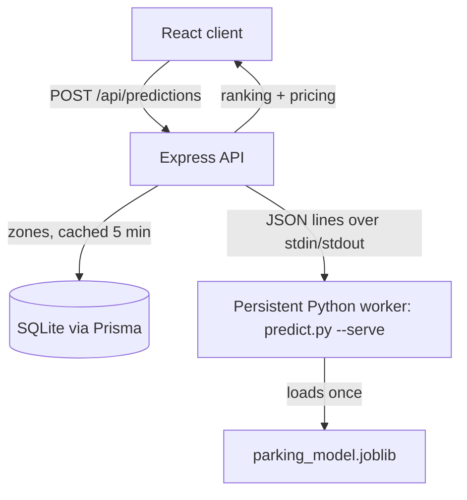

# ParkWise

> Predict. Compare. Park. Parking availability predictions for Koramangala, before you arrive.

ParkWise is a full stack web app that forecasts how full each parking zone in Koramangala will be at a chosen date and time, then ranks the zones by predicted free space, distance and price.

## Features

- **Occupancy forecasting**: a gradient boosting model (selected automatically against a random forest) predicts occupancy from hour, day of week, weekend flag, weather, nearby events and each zone's historical pattern.
- **Prediction ranges**: every prediction comes with an 80% range calibrated on held out data (split conformal), so you can see how certain the forecast is.
- **Honest evaluation**: the model is scored on the most recent 14 days it never saw during training and compared against a naive "historical average for that hour" baseline.
- **Ranking engine**: weighted score of availability (55%), distance from the area centre (30%) and the price you will actually pay (15%).
- **Dynamic pricing**: discount when a lot is mostly empty, surge when it is nearly full.
- **Interactive map**: Leaflet + OpenStreetMap markers coloured by availability and sized by capacity.
- **Reliability warnings**: requests outside the hours covered by historical data are flagged as extrapolations.

## Model accuracy

Measured on a chronological holdout (last 14 of 120 simulated days, 1,792 records):

| Metric | ParkWise model | Historical average baseline |
|---|---|---|
| MAE | **4.97 pts** | 5.42 pts |
| RMSE | 6.21 pts | n/a |
| R² | 0.885 | 0.864 |
| 80% range | ±8.2 pts, 80.1% observed coverage | n/a |

The simulated data contains roughly 6 points of irreducible day to day noise, so an MAE near 4.7 is the practical floor. Exact numbers are printed by `npm run train:model` and shown in the app under "How accurate is this prediction?".

## Tech stack

- **Frontend**: React 19, TypeScript, Vite, Tailwind CSS, React Leaflet
- **Backend**: Node.js, Express 5, TypeScript, Prisma ORM, SQLite
- **Machine learning**: Python, scikit-learn, pandas, joblib

## Prerequisites

- Node.js 20+
- Python 3.10+ with `pip`

## Getting started

```bash
npm install
pip install -r ml/requirements.txt
cp .env.example .env
```

Create and seed the database (8 zones, 120 days of hourly history), then train the model:

```bash
npm run db:generate
npm run db:push
npm run db:seed
npm run train:model
```

Run the API and the client together, then open `http://localhost:5173`:

```bash
npm run dev
```

## Production

```bash
npm run build
npm start
```

`npm start` serves the API and the built client from one origin on `PORT` (default 4000). Configuration lives in `.env` (see `.env.example`):

| Variable | Purpose | Default |
|---|---|---|
| `DATABASE_URL` | SQLite file used by Prisma | `file:./parkwise.db` |
| `PORT` | HTTP port | `4000` |
| `PYTHON_BIN` | Python interpreter for predictions | `python` (Windows) / `python3` |
| `CORS_ORIGIN` | Comma separated origins allowed cross origin | same origin only |
| `PREDICTION_TIMEOUT_MS` | Per request prediction timeout | `20000` |

## Checks

```bash
npm run typecheck
npm test
npm run build
```

`npm test` runs the server unit tests (validation and ranking) and the Python unit tests (feature pipeline, timestamp parsing, prediction ranges).

## How it works



1. The client sends the date, time, weather and event flag.
2. The API validates the request (real calendar dates, 24 hour times) and loads the zones.
3. A long lived Python worker, which keeps the model in memory, returns occupancy and a likely range for each zone. It restarts automatically if it crashes or times out.
4. The API converts occupancy to availability, applies dynamic pricing, ranks the zones and explains the top pick.

The model only predicts occupancy; ranking and pricing live in `server/src/services/recommendation.ts`, so business rules can change without retraining.

### Simulated data

`prisma/seed.ts` generates reproducible history with a seeded random generator. Each zone has its own demand profile (mall, curbside, office, college, market). Weather and events are drawn per day, events affect zones near the centre most, and every zone carries correlated day to day variation plus hourly noise. Timestamps store local wall clock time encoded as UTC.

## API reference

### `GET /api/health`
Returns `{ "status": "ok" }`.

### `GET /api/zones`
Returns all Koramangala parking zones: `id`, `name`, `area`, `latitude`, `longitude`, `totalSpaces`, `hourlyPrice`.

### `POST /api/predictions`

Request:

```json
{ "date": "2026-11-14", "time": "18:00", "weather": "rainy", "hasEvent": true }
```

`weather` is one of `clear`, `cloudy`, `rainy`. Invalid input returns `400` with a `message`.

Response (abridged):

```json
{
  "request": { "area": "Koramangala", "date": "2026-11-14", "time": "18:00", "weather": "rainy", "hasEvent": true },
  "recommended": {
    "id": "kora-006", "name": "Jyoti Nivas College",
    "occupancyPercent": 30.7, "availabilityPercent": 69.3,
    "availabilityLow": 61.1, "availabilityHigh": 77.5,
    "estimatedFreeSpaces": 69, "distanceKm": 0.53,
    "status": "high", "hourlyPrice": 30, "suggestedHourlyPrice": 30,
    "recommendationScore": 0.79
  },
  "explanation": "Recommended for its 69.3% predicted availability (~69 of 100 spaces free), ...",
  "zones": ["...all zones ranked by recommendationScore..."],
  "modelMetrics": { "mae": 4.97, "baselineMae": 5.42, "r2": 0.885, "intervalHalfWidth": 8.2, "modelName": "Gradient Boosting", "...": "..." },
  "warnings": []
}
```

Availability status: **high** at 60% or more, **medium** from 30% to 60%, **low** below 30%.

## Project structure

- `client/` React frontend
- `server/` Express API, ranking engine, Python bridge and unit tests
- `ml/` feature pipeline, training, prediction worker and unit tests
- `prisma/` database schema and data simulation
